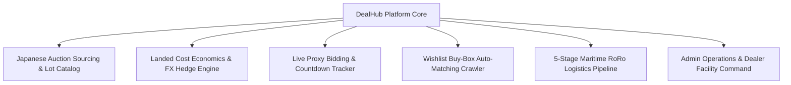
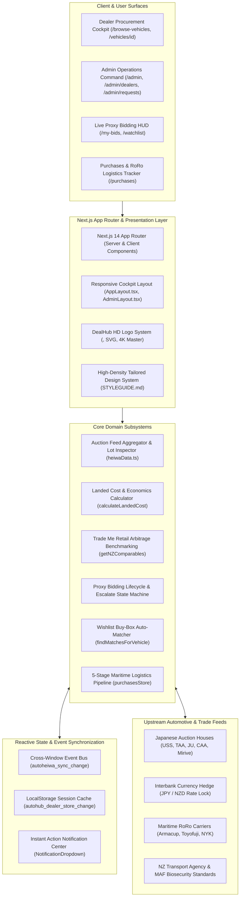
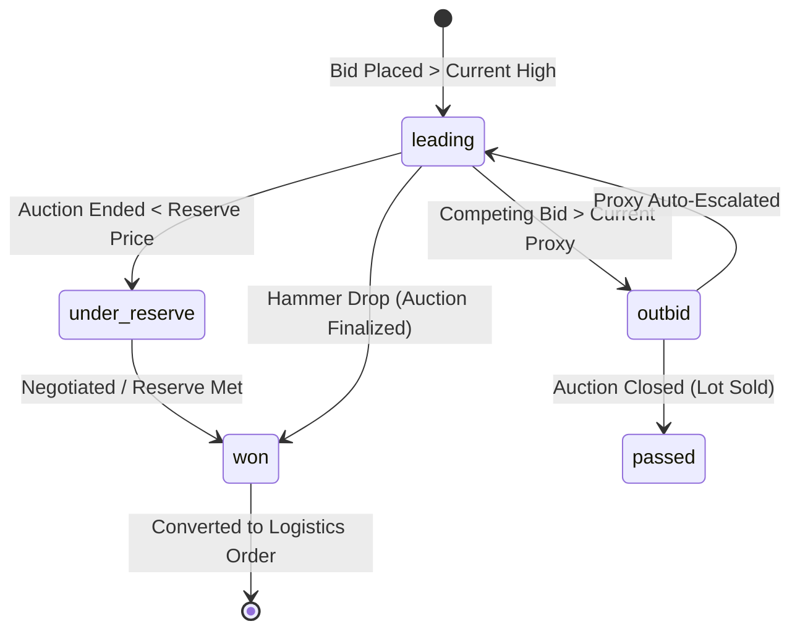
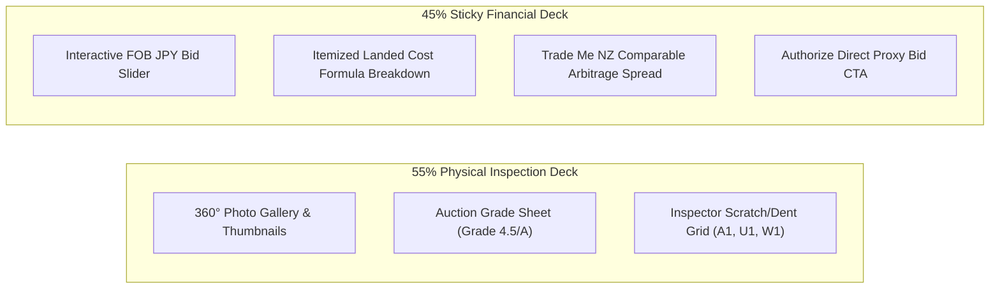
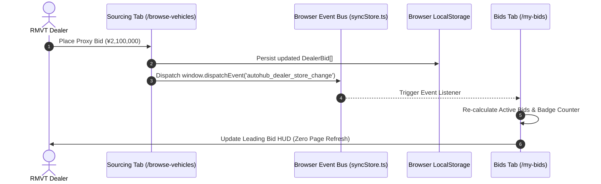
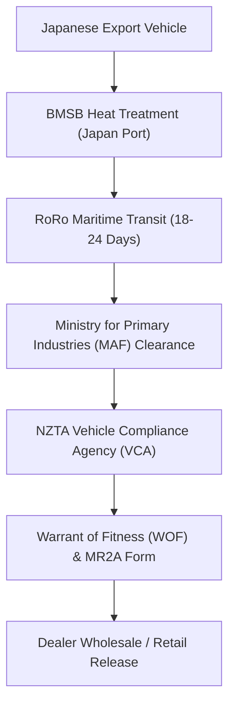

# DealHub — Enterprise System Architecture & Layout Blueprint

> **Document:** Platform Architecture, Subsystems & High-Density Layout Engineering  
> **Version:** 2.0  
> **Status:** Active / Production-Ready  
> **Frameworks:** Next.js 14 (App Router), React 18, TypeScript 5.0, Tailwind CSS 3.4, Lucide React  
> **Domain:** Cross-Border Automotive Procurement, Japanese Auction Telemetry & Landed Cost Arbitrage  

---

## 1. Executive Summary & Platform Scope

**DealHub** is an enterprise dealer intelligence and vehicle procurement engine connecting licensed New Zealand motor vehicle traders (RMVTs) directly with live Japanese auction house inventories (USS Tokyo, USS Nagoya, TAA, JU, Mirive, and Heiwa Auto). 

The platform eliminates guesswork from automotive importing by automating:
1. **Real-Time Landed Cost Economics**: Instant conversion of fluctuating FOB JPY auction bids into all-inclusive NZD landed costs (RoRo maritime freight, MAF/biosecurity heat treatment, NZTA compliance certification, port handling, and 15% GST).
2. **Market Arbitrage & Benchmark Intelligence**: Comparing incoming auction lots against active New Zealand retail market listings (Trade Me benchmark comparables, days-on-market velocity, and gross margin spreads).
3. **Automated Wishlist Buy-Box Crawler**: Scanning Japanese auction feeds against dealer buying criteria with instant match dispatching.
4. **End-to-End Logistical Visibility**: 5-stage procurement tracking from auction floor victory in Japan to delivery at dealer yards across Auckland, Wellington, Christchurch, and Tauranga.



---

## 2. High-Level System Architecture

DealHub adopts an edge-rendered modular architecture built on Next.js 14 App Router, balancing high-frequency auction telemetry on the client side with deterministic static generation for vehicle catalog exploration.



---

## 3. Information Architecture (IA) & Route Topology

Every route within DealHub maps to a deterministic operational persona, preventing redundant user flows:

```text
dealhub/
├── /                              # Root Redirect ➔ /browse-vehicles
├── /browse-vehicles               # Japan Auction Live Explorer & Faceted Filter Suite
│   └── ?make=&model=&year=&...    # Shareable URL search state query params
├── /vehicles/[id]                 # Dual-Engine Vehicle Detail & Landed Cost Simulator
├── /my-bids                       # Real-Time Proxy Bids Cockpit (Leading, Outbid, Won)
├── /watchlist                     # Saved Auction Watchlist with Closing Countdowns
├── /matches                       # Autonomous Wishlist Buy-Box Matched Lots
├── /purchases                     # 5-Stage Maritime Logistics Timeline & BOL Documents
├── /market                        # NZ Market Demand Intelligence & Turnover Spread
├── /profile                       # RMVT Dealer Credentials, Credit Facility & Rep Settings
├── /brand                         # Official Brand Identity, 4K Masters & HD Logo Assets
├── /styleguide                    # Interactive UI Styleguide & Better Layout Explorer
├── /login                         # Dual-Portal Quick Launcher (Dealer vs Admin)
└── /admin/                        # Admin Operations Command Center
    ├── /admin/dealers             # RMVT Dealer Accounts & Credit Limit Management
    ├── /admin/requests            # Sourcing Inquiries & Direct Reserve Inquiries
    ├── /admin/vehicles            # Inventory Overrides & Auction Batch Ingestion
    ├── /admin/wishlists           # Centralized Sourcing Aggregator & Match Broadcasting
    └── /admin                     # Executive KPI Dashboard (Volume, Landed Capital)
```

---

## 4. Role-Based Access Control (RBAC) & Persona Boundary Matrix

DealHub maintains strict operational boundaries between purchasing motor vehicle traders and back-office logistics administrators:

| Capability / Operational Flow | Licensed NZ Dealer (RMVT) | Admin Operations Executive | Unauthenticated Guest |
| :--- | :---: | :---: | :---: |
| **Browse Auction Inventory** | Full Access | Full Access | Read-Only (Masked Wholesale Price) |
| **Simulate Landed Cost (FOB ➔ NZD)** | Unrestricted | Unrestricted | Preview Mode |
| **Place & Escalate Proxy Bids** | Authorized (Credit-Scoped) | Super-User Override | Redirect to `/login` |
| **Configure Buy-Box Wishlists** | Personal Dealership Scope | Global Network View | Disabled |
| **Track RoRo Maritime Shipments** | Dealership Consignments | All Active Fleet Vessels | Disabled |
| **Modify Vehicle Inventory / FOB** | Read-Only | Read & Write Override | Denied |
| **Adjust Dealer Credit Limits** | View Limit | Grant / Suspend Credit | Denied |
| **Access System Architecture & Brand** | Full Access | Full Access | Full Access |

---

## 5. Core Technical Subsystems & Mathematical Formulas

### 1. Landed Cost Economics Engine
Located in [`src/lib/heiwaData.ts`](file:///f:/Project-Personal-Portfolio/dealhub/src/lib/heiwaData.ts#L143-L170).

The deterministic equation converting Japanese auction hammer price into landed NZD on yard:

$$\text{FOB}_{\text{NZD}} = \left\lfloor \frac{\text{FOB}_{\text{JPY}}}{\text{FX}_{\text{Rate}}} \right\rceil$$

$$\text{Subtotal} = \text{FOB}_{\text{NZD}} + \text{Freight}_{\text{RoRo}} + \text{Compliance}_{\text{NZTA}} + \text{MAF}_{\text{Biosecurity}} + \text{PortFees}$$

$$\text{GST} = \left\lfloor \text{Subtotal} \times 0.15 \right\rceil$$

$$\text{Total Landed Cost}_{\text{NZD}} = \text{Subtotal} + \text{GST}$$

$$\text{Gross Margin Spread} = \text{TradeMe Comparable}_{\text{NZD}} - \text{Total Landed Cost}_{\text{NZD}}$$

#### Fixed Cost Coefficients (NZD)
* $\text{FX}_{\text{Rate}}$: `91.24 JPY / NZD` (locked interbank hedge benchmark)
* $\text{Freight}_{\text{RoRo}}$: `$2,200 NZD` (Japan port to Auckland/Lyttelton maritime shipping)
* $\text{Compliance}_{\text{NZTA}}$: `$1,100 NZD` (Entry certification, WOF, and structural inspection)
* $\text{MAF}_{\text{Biosecurity}}$: `$280 NZD` (Heat treatment, biosecurity ramp clearance)
* $\text{GST}$: `15.0%` (New Zealand Goods and Services Tax on landed subtotal)

---

### 2. Autonomous Buy-Box Auto-Matching Algorithm
Located in [`src/lib/dealerStore.ts`](file:///f:/Project-Personal-Portfolio/dealhub/src/lib/dealerStore.ts#L485-L535).

Scans every incoming auction feed vehicle $V$ against dealer wishlist criteria set $W$:

$$\text{Match}(V, W) \iff \begin{cases} 
V.\text{make} = W.\text{make} \\
V.\text{model} = W.\text{model} \\
W.\text{yearFrom} \le V.\text{year} \le W.\text{yearTo} \\
V.\text{kms} \le W.\text{maxKms} \\
V.\text{totalLanded} \le W.\text{maxBudget}
\end{cases}$$

When $\text{Match}(V, W)$ evaluates to `true`, the system emits a cross-window notification to trigger an alert banner and badge increment on the dealer's top navigation bar.

---

### 3. Proxy Bidding Finite State Machine
Auction bids advance through 5 discrete states during the Japanese auction lifecycle:



---

## 6. High-Density & Better Layout Architectural Blueprints

DealHub defines **6 standardized, high-density layout blueprints** to solve complex multi-dimensional automotive auction data workflows:

---

### Blueprint 1: The 70/30 Auction Cockpit Split
* **Used on**: [`/browse-vehicles`](file:///f:/Project-Personal-Portfolio/dealhub/src/app/browse-vehicles/page.tsx), [`/matches`](file:///f:/Project-Personal-Portfolio/dealhub/src/app/matches/page.tsx)
* **Architectural Purpose**: Prevents layout fragmentation by decoupling the high-volume vehicle inventory scroll area from sticky operational controls.

```text
┌────────────────────────────────────────────────────────────────────────┐
│                        TOP NAVIGATION BAR (68px)                       │
├──────────────────────────────────────────┬─────────────────────────────┤
│   PRIMARY VEHICLE LOT EXPLORER (70%)     │  STICKY COCKPIT RAIL (30%)  │
│                                          │                             │
│ ┌──────────────────────────────────────┐ │ ┌─────────────────────────┐ │
│ │  Sticky Search & Filter Suite Chips  │ │ │  JPY/NZD Rate Lock HUD  │ │
│ └──────────────────────────────────────┘ │ └─────────────────────────┘ │
│                                          │ ┌─────────────────────────┐ │
│ ┌──────────────────┐┌──────────────────┐ │ │  Quick Proxy Escalator  │ │
│ │ Vehicle Card 1   ││ Vehicle Card 2   │ │ └─────────────────────────┘ │
│ └──────────────────┘└──────────────────┘ │ ┌─────────────────────────┐ │
│ ┌──────────────────┐┌──────────────────┐ │ │  Buy-Box Matches Feed   │ │
│ │ Vehicle Card 3   ││ Vehicle Card 4   │ │ └─────────────────────────┘ │
│ └──────────────────┘└──────────────────┘ │                             │
│                  ...                     │      (sticky top-20)        │
└──────────────────────────────────────────┴─────────────────────────────┘
```

#### CSS Grid Specification
```css
.auction-cockpit-grid {
  display: grid;
  grid-template-columns: 1fr;
  gap: 1.5rem;
}
@media (min-width: 1024px) {
  .auction-cockpit-grid {
    grid-template-columns: repeat(12, minmax(0, 1fr));
  }
  .auction-lot-stream {
    grid-column: span 8 / span 8;
  }
  .auction-telemetry-rail {
    grid-column: span 4 / span 4;
    position: sticky;
    top: 5rem;
  }
}
```

---

### Blueprint 2: The 4-Column Dealer KPI Metric Strip
* **Used on**: [`/admin`](file:///f:/Project-Personal-Portfolio/dealhub/src/app/admin/page.tsx), [`/my-bids`](file:///f:/Project-Personal-Portfolio/dealhub/src/app/my-bids/page.tsx), [`/market`](file:///f:/Project-Personal-Portfolio/dealhub/src/app/market/page.tsx)
* **Architectural Purpose**: Normalizes heterogeneous financial and operational telemetry into four standardized, equal-height visual cards with icon halos and trend indicators.

```text
┌─────────────────┐ ┌─────────────────┐ ┌─────────────────┐ ┌─────────────────┐
│ Active Bids     │ │ Landed on Water │ │ Gross Spread    │ │ Matched Lots    │
│ 12 Lots         │ │ $284,500 NZD    │ │ +$46,200 NZD    │ │ 9 Lots          │
│ [▲ +3 today]    │ │ [⚓ 4 Days Port] │ │ [▲ 18.4% Yield] │ │ [🔥 USS Tokyo]  │
└─────────────────┘ └─────────────────┘ └─────────────────┘ └─────────────────┘
```

---

### Blueprint 3: Dual-Engine Landed Cost Inspection Split
* **Used on**: [`/vehicles/[id]`](file:///f:/Project-Personal-Portfolio/dealhub/src/app/vehicles/[id]/page.tsx)
* **Architectural Purpose**: Solves the split-brain dilemma where a buyer must inspect condition sheets while recalculating landed margin spreads simultaneously.



---

### Blueprint 4: Master-Detail Logistics & Buy-Box Drawer
* **Used on**: [`/admin/requests`](file:///f:/Project-Personal-Portfolio/dealhub/src/app/admin/requests/page.tsx), [`/admin/dealers`](file:///f:/Project-Personal-Portfolio/dealhub/src/app/admin/dealers/page.tsx)
* **Architectural Purpose**: 40% scrollable operational queue on the left paired with a 60% persistent detail inspector on the right. On mobile devices, the right pane collapses into an animated slide-over sheet.

---

### Blueprint 5: 5-Stage Maritime Logistics Timeline
* **Used on**: [`/purchases`](file:///f:/Project-Personal-Portfolio/dealhub/src/app/purchases/page.tsx)
* **Architectural Purpose**: Provides deterministic milestone tracking for purchased vehicles spanning the 3 to 6 week transit window between Japan auction houses and NZ dealership yards:

```text
[1. Auction Won] ──➔ [2. RoRo Booking] ──➔ [3. Port & MAF] ──➔ [4. Compliance] ──➔ [5. Delivered]
   Yokohama Yard         Armacup Carrier       Auckland Port       NZTA VCA Yard      Penrose Dealership
   ✓ COMPLETED           ✓ COMPLETED           ● IN PROGRESS       ○ PENDING          ○ PENDING
```

---

### Blueprint 6: High-Density Table vs Immersive Card Mode
* **Used on**: [`/browse-vehicles`](file:///f:/Project-Personal-Portfolio/dealhub/src/app/browse-vehicles/page.tsx), [`/admin/vehicles`](file:///f:/Project-Personal-Portfolio/dealhub/src/app/admin/vehicles/page.tsx)
* **Architectural Purpose**: Allows high-frequency wholesale traders to toggle into a dense 38px spreadsheet view with sortable columns, while retail-focused managers browse high-resolution 16:9 photo cards.

---

## 7. Real-Time State Management & Event Bus Architecture

DealHub uses a lightweight, zero-dependency browser event bus for real-time synchronization between active tabs and modal dialogs:



### Event Bus Topic Registry
* `'autohub_dealer_store_change'`: Emitted on bid placement, watchlist toggles, and buy-box updates.
* `'autoheiwa_sync_change'`: Emitted on background auction lot ingestion and vehicle overrides.

---

## 8. Cross-Border Trade & Compliance Governance

Importing motor vehicles into New Zealand requires strict adherence to statutory and biosecurity regulations:



1. **Biosecurity & MAF Clearance**: All vehicles originating from Japan during Brown Marmorated Stink Bug (BMSB) season (Sept – April) must undergo certified offshore heat treatment before RoRo vessel loading.
2. **NZTA Entry Certification**: Compliance inspectors verify structural integrity, frontal impact standards, electronic stability control (ESC), and exhaust emissions (Euro 5/6 equivalence).
3. **15% Import GST Calculation**: Assessed on Customs Value (FOB converted + maritime insurance + overseas freight).

---

## 9. Governance & Documentation Cross-References

| Document | Purpose | File Link |
| :--- | :--- | :--- |
| **System Architecture** | Technical blueprint, domain models, formulas, and 6 layout patterns | [`ARCHITECTURE.md`](file:///f:/Project-Personal-Portfolio/dealhub/ARCHITECTURE.md) |
| **UI & Layout Styleguide** | Design tokens, typography hierarchy, component matrix, and layout standards | [`STYLEGUIDE.md`](file:///f:/Project-Personal-Portfolio/dealhub/STYLEGUIDE.md) |
| **Project Overview** | Setup guide, key features, directory structure, and deployment instructions | [`README.md`](file:///f:/Project-Personal-Portfolio/dealhub/README.md) |
| **Interactive Styleguide** | Live interactive component sandbox and real-time layout switcher | [`/styleguide`](file:///f:/Project-Personal-Portfolio/dealhub/src/app/styleguide/page.tsx) |
| **HD Brand Asset Center** | 4K master emblems, scalable vector SVG downloads, and component JSX | [`/brand`](file:///f:/Project-Personal-Portfolio/dealhub/src/app/brand/page.tsx) |
