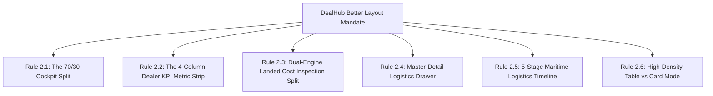
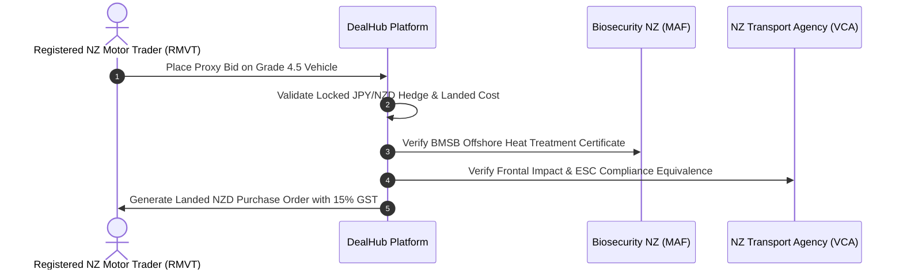
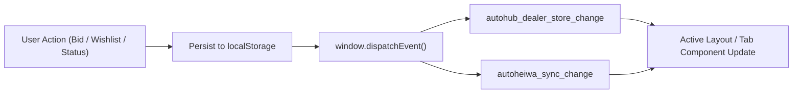

# DealHub — Engineering Rules & Layout Architecture Standards

> **Document:** Platform Engineering Rules, Layout Architecture Principles & Compliance Governance  
> **Platform:** DealHub · Dealer Intelligence Platform (Japan to New Zealand Automotive Sourcing)  
> **Version:** 2.0  
> **Status:** Active / Production-Mandate  
> **Scope:** All engineers, designers, and contributors to DealHub must strictly adhere to these rules.  

---

## 1. Core Engineering Principles & Technology Stack

1. **Next.js 14 App Router Framework**:
   * All pages must reside within `src/app/` using App Router conventions (`page.tsx`, `layout.tsx`, `error.tsx`, `loading.tsx`).
   * Explicitly designate Client Components with `"use client";` at the top of the file when using hooks (`useState`, `useEffect`, `useRouter`, `usePathname`).
   * Keep server/client component boundaries as low in the component tree as possible.
2. **TypeScript Strictness**:
   * All domain models (`HeiwaVehicle`, `DealerBid`, `DealerRequest`, `WishListCriteria`, `NZComparable`) must use strict TypeScript types from [`src/lib/heiwaData.ts`](file:///f:/Project-Personal-Portfolio/dealhub/src/lib/heiwaData.ts) or [`src/lib/dealerStore.ts`](file:///f:/Project-Personal-Portfolio/dealhub/src/lib/dealerStore.ts).
   * **Zero `any` Policy**: Never cast domain entities or API responses to `any`.
3. **Styling & CSS Architecture**:
   * Use **Tailwind CSS** utilities with semantic tokens defined in `tailwind.config.ts` and [`src/app/globals.css`](file:///f:/Project-Personal-Portfolio/dealhub/src/app/globals.css).
   * Never introduce arbitrary inline styles when standard tokens exist.
   * Maintain the dark cockpit aesthetic (`#0A1322`, `#0F1B2E`) for operational dashboards and high-contrast surfaces for financial readouts.

---

## 2. Better Layout Architectural Standards

All pages and user interfaces in DealHub must implement one of the **6 approved layout architectural patterns**. Ad-hoc, unstructured page layouts are strictly prohibited.



### Rule 2.1: The 70/30 Auction Cockpit Split
* **Applicable Views**: Inventory catalogs, live auction feeds, wishlist match views ([`/browse-vehicles`](file:///f:/Project-Personal-Portfolio/dealhub/src/app/browse-vehicles/page.tsx), [`/matches`](file:///f:/Project-Personal-Portfolio/dealhub/src/app/matches/page.tsx)).
* **Mandatory Structure**:
  * **Left Column (70% / `lg:col-span-8`)**: Scrollable inventory cards or tables with faceted search filters.
  * **Right Column (30% / `lg:col-span-4`)**: Sticky operational rail (`sticky top-20`) containing JPY/NZD rate locks, quick-bid escalators, and active buy-box match radars.
* **Prohibited**: Never allow the right telemetry rail to scroll off-screen on desktop viewports.

### Rule 2.2: The 4-Column Dealer KPI Metric Strip
* **Applicable Views**: Executive dashboards, financial summaries ([`/admin`](file:///f:/Project-Personal-Portfolio/dealhub/src/app/admin/page.tsx), [`/my-bids`](file:///f:/Project-Personal-Portfolio/dealhub/src/app/my-bids/page.tsx), [`/market`](file:///f:/Project-Personal-Portfolio/dealhub/src/app/market/page.tsx)).
* **Mandatory Structure**:
  * Responsive layout: `grid-cols-1 sm:grid-cols-2 lg:grid-cols-4 gap-4`.
  * Every card must contain:
    1. Icon halo badge with subtle ambient tint.
    2. Primary metric in bold tabular numbers (`font-mono tabular-nums`).
    3. Secondary contextual status or trend pill (`+14.2% vs last week`, `4 Leading`).
* **Prohibited**: Do not mix card heights within a single metric row.

### Rule 2.3: Dual-Engine Landed Cost Inspection Split
* **Applicable Views**: Vehicle detail & bidding views ([`/vehicles/[id]`](file:///f:/Project-Personal-Portfolio/dealhub/src/app/vehicles/[id]/page.tsx)).
* **Mandatory Structure**:
  * **Left Pane (55%)**: Physical inspection assets (high-res 360° photography, auction sheet grade 4.5/B, inspector notes).
  * **Right Pane (45%)**: Financial intelligence engine with interactive FOB JPY simulation slider, line-by-line landed cost audit (freight, compliance, MAF, GST), and Trade Me comparable spread.
* **Prohibited**: Never display an estimated landed cost without displaying the itemized formula breakdown.

### Rule 2.4: Master-Detail Logistics & Buy-Box Drawer
* **Applicable Views**: Inquiries, dealer management ([`/admin/requests`](file:///f:/Project-Personal-Portfolio/dealhub/src/app/admin/requests/page.tsx), [`/admin/dealers`](file:///f:/Project-Personal-Portfolio/dealhub/src/app/admin/dealers/page.tsx)).
* **Mandatory Structure**:
  * Split pane: 40% queue on left, 60% inspector on right.
  * Mobile fallback: Automatically collapse into an animated bottom sheet or slide-over drawer with touch swipe dismissal.

### Rule 2.5: 5-Stage Maritime Logistics Timeline
* **Applicable Views**: Purchase orders, shipping tracking ([`/purchases`](file:///f:/Project-Personal-Portfolio/dealhub/src/app/purchases/page.tsx)).
* **Mandatory Structure**:
  * Discrete milestone sequence: `1. Auction Won` ➔ `2. RoRo Booking` ➔ `3. Port & MAF` ➔ `4. Compliance` ➔ `5. Delivered`.
  * Explicit state indicators: `COMPLETED` (green check), `IN_PROGRESS` (pulsing blue), `PENDING` (slate).
  * Direct document access (Auction Sheet, Export Certificate, MAF Biosecurity Certificate).

### Rule 2.6: High-Density Table vs Card Mode
* **Applicable Views**: Large catalogs ([`/browse-vehicles`](file:///f:/Project-Personal-Portfolio/dealhub/src/app/browse-vehicles/page.tsx), [`/admin/vehicles`](file:///f:/Project-Personal-Portfolio/dealhub/src/app/admin/vehicles/page.tsx)).
* **Mandatory Structure**:
  * Provide a unified view toggle allowing users to switch between:
    * `Grid Mode`: Visual cards with 16:9 vehicle photography.
    * `Table Mode`: Compact 38px spreadsheet rows with sortable column headers.

---

## 3. Layout Anti-Patterns (Strictly Prohibited)

> [!CAUTION]
> The following design and layout patterns are strictly prohibited in the DealHub codebase:

1. **Unpinned Primary Actions**: Placing critical bid escalation buttons at the very bottom of a 3000px scrollable vehicle page.
2. **Hidden Landed Cost Formulas**: Showing an NZD price without itemizing RoRo maritime shipping ($2,200), MAF biosecurity ($280), NZTA compliance ($1,100), and 15% GST.
3. **Full-Page Reloads on Bidding**: Refreshing the browser window when placing proxy bids or adjusting buy-box criteria. Always use optimistic state updates with the event bus.
4. **Horizontal Mobile Overflow**: Breaking responsive mobile containers with un-truncated vehicle chassis strings or non-wrapping tables.
5. **Generic Placeholder Imagery**: Using unbranded gray placeholder boxes. Always use high-resolution vehicle assets from `public/vehicles/` or generate official HD masters.

---

## 4. Cross-Border Trade & Statutory Compliance Rules

DealHub operates under New Zealand motor vehicle trading and biosecurity regulations. All platform features must respect these operational bounds:



1. **Landed Cost Calculation Mandate**:
   * All calculations must use the standardized function `calculateLandedCost(fobJpy)` from [`src/lib/heiwaData.ts`](file:///f:/Project-Personal-Portfolio/dealhub/src/lib/heiwaData.ts).
   * The formula must strictly apply:
     $$\text{Total Landed} = \left(\frac{\text{FOB}_{\text{JPY}}}{\text{FX}_{\text{Rate}}} + \text{Freight} + \text{Compliance} + \text{PortFees}\right) \times 1.15$$
2. **Biosecurity & BMSB Compliance**:
   * During the Brown Marmorated Stink Bug (BMSB) season (September 1 – April 30), any vehicle dispatched from Japan ports must require verified offshore heat treatment clearance before RoRo vessel boarding.
3. **NZTA Entry Certification Standards**:
   * Vehicles must meet NZTA Rule 32015 for Electronic Stability Control (ESC) and frontal impact compliance.
4. **RMVT Licensing & Trade Security**:
   * Wholesale auction bidding is strictly restricted to licensed Motor Vehicle Traders holding an active RMVT number.

---

## 5. State Management & Event Bus Protocol

To maintain zero-latency responsiveness across browser tabs without server polling loops:



1. **Event Dispatching**:
   * When modifying bids, watchlists, or sourcing requests, always dispatch `'autohub_dealer_store_change'` using helper functions in [`src/lib/dealerStore.ts`](file:///f:/Project-Personal-Portfolio/dealhub/src/lib/dealerStore.ts).
   * When modifying vehicle inventory or background feeds, dispatch `'autoheiwa_sync_change'` via [`src/lib/syncStore.ts`](file:///f:/Project-Personal-Portfolio/dealhub/src/lib/syncStore.ts).
2. **Event Listening**:
   * Layout headers and badge counters must subscribe to event listeners in `useEffect` and properly unbind them in the cleanup return function to prevent memory leaks.

```tsx
// Standard event bus listener pattern
useEffect(() => {
  const handleStoreChange = () => refreshBadgeCounts();
  window.addEventListener('autohub_dealer_store_change', handleStoreChange);
  return () => window.removeEventListener('autohub_dealer_store_change', handleStoreChange);
}, []);
```

---

## 6. Information Architecture & Navigation Rules

1. **Navigation Consistency**:
   * All dealer pages must use [`AppLayout`](file:///f:/Project-Personal-Portfolio/dealhub/src/components/layout/AppLayout.tsx).
   * All back-office operations pages must use [`AdminLayout`](file:///f:/Project-Personal-Portfolio/dealhub/src/components/layout/AdminLayout.tsx).
2. **Brand & Logo Integrity**:
   * Always render the official [`<DealHubLogo />`](file:///f:/Project-Personal-Portfolio/dealhub/src/components/common/DealHubLogo.tsx) component in top brand headers. Never use raw image tags with hardcoded white backgrounds in dark layouts.
3. **Global Shortcuts**:
   * Maintain the global `Ctrl + K` search shortcut and `/` quick search trigger across all platform layouts.
   * Maintain the `Ctrl + B` sidebar collapse toggle.

---

## 7. Quality Assurance & Pull Request Mandates

Before submitting any code changes or merging pull requests:
1. **Type Checking**: Run `npx tsc --noEmit` — 0 TypeScript errors allowed.
2. **Production Bundle Verification**: Run `npm run build` — all routes must compile and statically generate successfully.
3. **Lint Compliance**: Run `npm run lint` — adhere to ESLint Next.js configuration.
4. **Documentation Sync**: When introducing new routes or layouts, update [`ARCHITECTURE.md`](file:///f:/Project-Personal-Portfolio/dealhub/ARCHITECTURE.md), [`STYLEGUIDE.md`](file:///f:/Project-Personal-Portfolio/dealhub/STYLEGUIDE.md), and [`README.md`](file:///f:/Project-Personal-Portfolio/dealhub/README.md).

---

## 8. Governance & Documentation Cross-References

* 🏗️ **Platform System Architecture**: [`ARCHITECTURE.md`](file:///f:/Project-Personal-Portfolio/dealhub/ARCHITECTURE.md)
* 🎨 **UI Styleguide & Design Tokens**: [`STYLEGUIDE.md`](file:///f:/Project-Personal-Portfolio/dealhub/STYLEGUIDE.md)
* ⚡ **Live Interactive Styleguide**: [`/styleguide`](file:///f:/Project-Personal-Portfolio/dealhub/src/app/styleguide/page.tsx)
* 💎 **Brand Identity & HD Logo Center**: [`/brand`](file:///f:/Project-Personal-Portfolio/dealhub/src/app/brand/page.tsx)
* 📖 **Project README & Getting Started**: [`README.md`](file:///f:/Project-Personal-Portfolio/dealhub/README.md)
