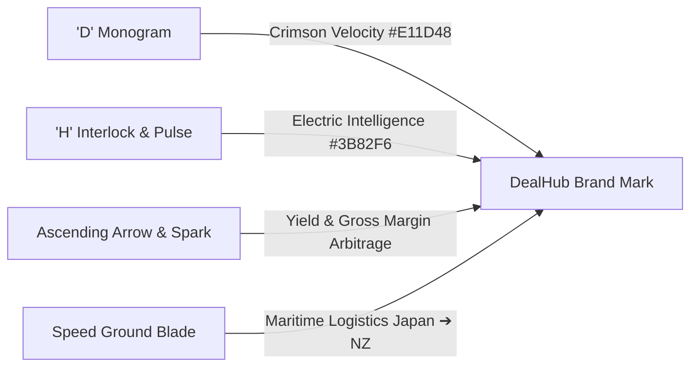
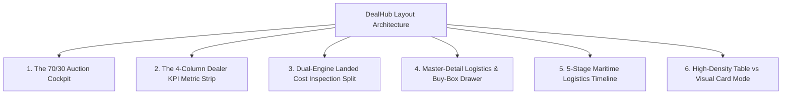
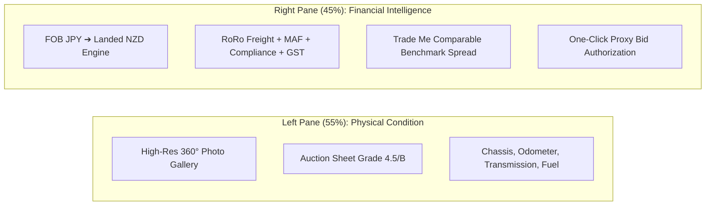

# DealHub — UI & Layout Design System Styleguide

> **Document:** Enterprise UI Design System & High-Density Layout Standards  
> **Platform:** DealHub · Dealer Intelligence Platform (Japan to New Zealand Automotive Sourcing)  
> **Version:** 2.0  
> **Frameworks:** Next.js 14 (App Router), Tailwind CSS v3.4, React 18, Lucide React Icons  
> **Aesthetic Archetype:** High-Velocity Dark Cockpit & Clean Executive Data Density  

---

## 1. Visual Identity & HD Logo Standards

The **DealHub** brand identity reflects high-frequency automotive sourcing intelligence, cross-border auction arbitrage, and precision landed-cost economics.



### Official Logo Component: `<DealHubLogo />`
Located in [`src/components/common/DealHubLogo.tsx`](file:///f:/Project-Personal-Portfolio/dealhub/src/components/common/DealHubLogo.tsx).

```tsx
import DealHubLogo, { HDLogo } from "@/components/common/DealHubLogo";

// 1. Primary Header Brand (Navbar / Sidebar Header)
<DealHubLogo
  variant="full"
  size="md"
  subBadge="DEALER"
  subBadgeColor="sky"
  glow={true}
  href="/browse-vehicles"
/>

// 2. Admin Operations Brand
<DealHubLogo
  variant="full"
  size="md"
  subBadge="ADMIN OPS"
  subBadgeColor="rose"
  glow={true}
  href="/admin"
/>

// 3. Compact Mini-Sidebar Emblem
<DealHubLogo
  variant="mark"
  size="md"
  isMini={true}
  href="/browse-vehicles"
/>

// 4. Standalone 4K Glossy 3D App Icon
<DealHubLogo
  variant="mark"
  mode="hd-image"
  size="xl"
/>
```

### Logo Sizing & Clear Space Rules
* **Minimum Clear Space**: `1x` mark radius on all 4 quadrants.
* **Minimum Dimensions**:
  * Micro Favicon: `24px` × `24px`
  * Sidebar Header: `40px` emblem box, `68px` total container height
  * Hero Display: `60px` – `80px` emblem size
* **Color Usage**:
  * On Dark Backgrounds (`#070D18`, `#0A1322`): Use default `theme="dark"` (crisp white text with `#E11D48` crimson accent and `#60A5FA` subtitle).
  * On Light Backgrounds (`#FFFFFF`, `#F3F5F8`): Use `theme="light"` (deep obsidian text `#0A1322` and blue accent `#2563EB`).

---

## 2. Color Palette & Design Tokens

DealHub employs a high-contrast dark cockpit theme for telemetry/bidding with daylight-balanced surfaces for data reading.

### Primary Brand Palette
| Token Name | HEX | RGB | Tailwind Class | Semantic Purpose |
| :--- | :--- | :--- | :--- | :--- |
| **Crimson Velocity** | `#E11D48` | `rgb(225, 29, 72)` | `bg-rose-600` / `text-rose-600` | Primary brand accent, live bids, urgent actions |
| **Crimson Vivid** | `#FF385C` | `rgb(255, 56, 92)` | `bg-rose-500` / `text-rose-500` | Glowing neon borders, active hover states |
| **Crimson Dark** | `#BE123C` | `rgb(190, 18, 60)` | `bg-rose-700` | Gradient shadows, button press active states |
| **Obsidian Navy (Base)** | `#0A1322` | `rgb(10, 19, 34)` | `bg-[#0A1322]` | Primary sidebar, dark hero canvas, headers |
| **Obsidian Navy (Card)** | `#0F1B2E` | `rgb(15, 27, 46)` | `bg-secondary` / `bg-[#0F1B2E]` | Card surfaces, dropdown flyouts, dark dialogs |
| **Electric Intelligence**| `#2563EB` | `rgb(37, 99, 235)` | `bg-blue-600` / `text-blue-600` | Data visualizations, FOB conversions, Trade Me comps |
| **Electric Sky** | `#60A5FA` | `rgb(96, 165, 250)` | `text-sky-400` / `text-blue-400` | Subtitles, analytical badges, technical metadata |

### Semantic Financial & Operational Tokens
| Status / Metric | HEX | Background | Text Color | Usage Example |
| :--- | :--- | :--- | :--- | :--- |
| **High Arbitrage Margin** | `#059669` | `bg-emerald-500/10` | `text-emerald-400` | Spread > $4,000 NZD gross profit |
| **Moderate Margin** | `#2563EB` | `bg-blue-500/10` | `text-blue-400` | Spread $2,000 – $4,000 NZD |
| **Low / Thin Margin** | `#D97706` | `bg-amber-500/10` | `text-amber-400` | Spread < $2,000 NZD caution threshold |
| **Leading Bid** | `#059669` | `bg-emerald-50 text-emerald-700` | `border-emerald-200` | Dealer is current auction frontrunner |
| **Outbid Alert** | `#E11D48` | `bg-rose-50 text-rose-700` | `border-rose-200` | Another buyer placed higher proxy bid |
| **Under Reserve** | `#7C3AED` | `bg-purple-50 text-purple-700` | `border-purple-200` | Bid is highest but reserve not yet met |

---

## 3. Typography Scale & Hierarchies

Typography is anchored on **Inter** with fallbacks to system typography. Financial data and auction codes use tabular numerical alignments.

```text
Display Hero (32px - 40px)    Inter 900 Black     tracking-tight leading-tight
Page Title (24px - 28px)      Inter 800 ExtraBold tracking-tight leading-snug
Section Header (18px - 20px)  Inter 700 Bold      tracking-normal leading-snug
KPI Financial Stat (26px)     Inter 900 Black     font-mono tabular-nums
Body Primary (14px)           Inter 500 Medium    leading-relaxed text-slate-700 / slate-200
Meta / Micro Badge (11px)     Inter 700 Bold      tracking-wider uppercase
```

### Typography Utility Rules
* **Financial Figures**: Always apply `font-mono tabular-nums tracking-tight` to avoid layout jitter during live updates.
* **Corridor & Sourcing Badges**: Always use `uppercase tracking-[0.14em] font-extrabold text-[9px] - text-[11px]`.
* **Vehicle Stock Numbers**: Format as `Stock #XXXX` in bold mono font.

---

## 4. Better Layout Architectural Patterns

DealHub implements **6 standardized, high-density layout blueprints** to solve complex multi-dimensional automotive auction data workflows:



---

### Pattern 1: The 70/30 Auction Cockpit Split
> **Problem Solved**: Dealers need to browse hundreds of incoming Japanese auction lots without losing sight of active proxy bidding countdowns, exchange rate fluctuations, or market telemetry.

* **Left Primary Column (70%)**:
  * Sticky search, multi-faceted filtering chips (Make, Model, Year, Fuel, Grade 4.5+).
  * 2 or 3-column responsive vehicle lot cards with auction countdown badge and high-res imagery.
* **Right Operational Rail (30%)**:
  * Sticky (`sticky top-20`) live telemetry sidebar.
  * Real-time JPY/NZD exchange rate lock indicator.
  * Quick Proxy Bid Escalator widget.
  * Saved wishlist matching feed.

```tsx
<div className="grid grid-cols-1 lg:grid-cols-12 gap-6 items-start">
  {/* 70% Primary Inventory & Filter Queue */}
  <div className="lg:col-span-8 space-y-6">
    <SearchAndFilterToolbar />
    <div className="grid grid-cols-1 md:grid-cols-2 gap-5">
      {vehicles.map(v => <VehicleCard key={v.id} vehicle={v} />)}
    </div>
  </div>

  {/* 30% Sticky Cockpit Sidebar */}
  <div className="lg:col-span-4 sticky top-20 space-y-5">
    <ForexRateLockWidget />
    <QuickBidEscalator />
    <WishlistAlertsRail />
  </div>
</div>
```

---

### Pattern 2: The 4-Column Dealer KPI Metric Strip
> **Problem Solved**: Executives and dealers need at-a-glance visibility into purchasing power, active bids, landed stock in transit, and total margin opportunity.

* Standardized responsive grid: `grid-cols-2 lg:grid-cols-4 gap-4`.
* Every card features:
  1. Icon halo badge with subtle ambient tint.
  2. Tabular numerical counter.
  3. Contextual micro trend pill (`+14.2% vs last week`, `3 Ending in <2h`).

```tsx
<div className="grid grid-cols-1 sm:grid-cols-2 lg:grid-cols-4 gap-4">
  <KpiCard
    title="Active Proxy Bids"
    value="12"
    subValue="4 Leading · 2 Outbid"
    icon={Gavel}
    iconColor="text-rose-400 bg-rose-500/10"
    trend="+3 today"
    trendDirection="up"
  />
  <KpiCard
    title="Landed Cost in Transit"
    value="$284,500 NZD"
    subValue="8 Vessels on Water"
    icon={Ship}
    iconColor="text-blue-400 bg-blue-500/10"
    trend="RoRo On-Schedule"
  />
  <KpiCard
    title="Projected Gross Margin"
    value="$46,200 NZD"
    subValue="Avg $3,850/unit"
    icon={TrendingUp}
    iconColor="text-emerald-400 bg-emerald-500/10"
    trend="18.4% ROI"
    trendDirection="up"
  />
  <KpiCard
    title="Wishlist Buy-Box Matches"
    value="9 Lots"
    subValue="3 Grade 4.5+ Hybrids"
    icon={Sparkles}
    iconColor="text-amber-400 bg-amber-500/10"
    trend="Fresh Heiwa Feed"
  />
</div>
```

---

### Pattern 3: Dual-Engine Landed Cost Inspection Split (Vehicle Details)
> **Problem Solved**: Vehicle purchase decisions require analyzing physical auction inspection grades while simultaneously simulating customs fees, RoRo shipping, and Trade Me market comparables.



* **Left Pane (55%)**:
  * Multi-angle high-resolution gallery with thumbnail selector.
  * Inspection inspector marks (A1 scratches, U1 small dents, interior smoke rating).
* **Right Pane (45%)**:
  * Interactive FOB JPY slider recalculating NZD landed cost on each tick.
  * Itemized line-by-line financial audit:
    * `FOB JPY Converted`: NZD equivalent at locked interbank rate.
    * `Maritime RoRo Freight`: Japan port to Auckland/Lyttelton.
    * `Biosecurity & MAF Inspection`: Heat treatment & biosecurity clearance.
    * `Entry Certification & Compliance`: NZ Transport Agency compliance fee.
    * `GST (15%)`: Applicable import goods and services tax.
    * `Gross Margin Spread`: Comparison against active Trade Me retail comparables.

---

### Pattern 4: Master-Detail Logistics & Buy-Box Drawer
> **Problem Solved**: Managing hundreds of sourcing requests or logistics shipments without navigating back and forth across multiple browser pages.

* **Desktop View**: Split pane layout.
  * 40% scrollable queue on the left.
  * 60% persistent detail inspector on the right.
* **Mobile / Tablet View**: Automatically collapses the right pane into an animated bottom sheet or full-width slide-over modal with touch-friendly swipe dismissal.

---

### Pattern 5: 5-Stage Maritime Logistics Timeline
> **Problem Solved**: Vehicles take 3 to 6 weeks from auction win in Tokyo/Nagoya to yard arrival in New Zealand. Dealers require deterministic milestone tracking.

```mermaid
stateDiagram-v2
    direction LR
    [*] --> AuctionWon: Japan Auction Won
    AuctionWon --> RoRoBooking: Vessel Booking & RoRo Shipping
    RoRoBooking --> PortCustoms: NZ Port Customs & MAF Inspection
    PortCustoms --> Compliance: Compliance & Warrant of Fitness
    Compliance --> YardDelivery: Delivered to Dealer Yard
    YardDelivery --> [*]
```



* Each milestone includes:
  * Stage Status: `COMPLETED` (green check), `IN_PROGRESS` (pulsing blue), `UPCOMING` (muted slate).
  * Vessel Name & Bill of Lading (BOL) tracking number.
  * ETA Date with countdown days remaining.
  * Direct document download (Auction Sheet, Export Certificate, MAF Biosecurity Certificate).

---

### Pattern 6: High-Density Table vs Immersive Card Mode
> **Problem Solved**: Fast desktop wholesale buyers want dense 40-row spreadsheets with keyboard shortcuts, while retail dealership managers prefer rich photo cards.

* Unified view toggle: `Grid View` (rich cards with 16:9 imagery) vs `Table View` (dense 38px rows with sortable column headers).
* Table rows support inline bid quick-adjust, watchlist pinning, and landed cost hover tooltips.

---

## 5. Component Library Standards

### 1. Vehicle Auction Card Anatomy
```text
┌────────────────────────────────────────────────────────┐
│ [LIVE AUCTION: 02h 14m]                 [❤️ Watchlist] │
│ ┌────────────────────────────────────────────────────┐ │
│ │                                                    │ │
│ │          16:9 High-Res Vehicle Photo               │ │
│ │                                                    │ │
│ └────────────────────────────────────────────────────┘ │
│ Grade: 4.5/B   •   2019 Toyota C-HR Hybrid   •   42k km│
│                                                        │
│ FOB Japan: ¥1,850,000      NZ Landed Cost: $27,850 NZD │
│ Trade Me Comparable: $33,900 NZD   [Margin: +$6,050]   │
│                                                        │
│ [ Quick Inspect ]                   [ Place Proxy Bid ]│
└────────────────────────────────────────────────────────┘
```

### 2. Button Design Matrix
| Type | Styling | Usage |
| :--- | :--- | :--- |
| **Primary Action** | `bg-gradient-to-r from-rose-600 to-rose-700 hover:from-rose-500 hover:to-rose-600 text-white font-bold rounded-xl shadow-lg shadow-rose-950/40` | Place Proxy Bid, Submit Buy-Box |
| **Secondary Neutral** | `bg-white/[0.06] hover:bg-white/[0.12] text-slate-200 border border-white/10 rounded-xl` | Filter Reset, View Specs |
| **Success Financial** | `bg-emerald-600 hover:bg-emerald-500 text-white font-bold rounded-xl shadow-md shadow-emerald-950/40` | Lock Deal, Approve Sourcing |
| **Destructive / Outbid** | `bg-rose-500/10 text-rose-400 border border-rose-500/20 hover:bg-rose-500/20` | Cancel Bid, Remove Lot |

### 3. Badge Matrix
```tsx
// Margin Spread Pill
<span className="inline-flex items-center gap-1 px-2.5 py-1 rounded-full text-xs font-black bg-emerald-500/15 text-emerald-400 border border-emerald-500/30">
  <TrendingUp size={12} /> +$4,850 NZD Gross Spread
</span>

// Auction Countdown Tag
<span className="inline-flex items-center gap-1 px-2 py-0.5 rounded-md text-[11px] font-bold bg-rose-500/20 text-rose-300 border border-rose-500/40">
  <Clock size={11} /> 01h 44m
</span>

// Inspection Grade Tag
<span className="px-2 py-0.5 rounded font-black text-xs bg-slate-800 text-white border border-slate-700">
  Grade 4.5 / B
</span>
```

---

## 6. Accessibility, Performance & Breakpoint Standards

* **Touch Targets**: Minimum `44px × 44px` on all mobile clickable elements (bid buttons, modal close triggers).
* **Keyboard Shortcuts**:
  * `Ctrl + K` or `/`: Global vehicle and dealer search modal.
  * `Ctrl + B`: Toggle sidebar collapse (full vs mini mode).
  * `Escape`: Dismiss search dialogs and inspection drawers.
* **Responsive Breakpoints**:
  * `sm` (`640px`): Single-column cards stack; mobile navigation drawer enabled.
  * `md` (`768px`): Dual-column metric cards; filters expand.
  * `lg` (`1024px`): 70/30 Cockpit split becomes active; full sidebar navigation renders.
  * `xl` (`1280px`): 3-column inventory grid; detailed margin telemetry expanded.
  * `2xl` (`1536px`): High-density data grid mode with 4-wide vehicle display.
* **Color Contrast**: All primary text adheres to WCAG AA `4.5:1` ratio against `#0A1322` and `#0F1B2E` backgrounds.
